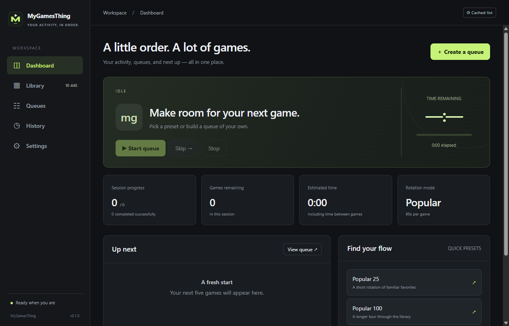

# MyGamesThing

A Windows-focused **Discord game activity manager / rotator**, built with Electron and vanilla JavaScript. Based on / derived from [PresencePal by foxmanhwa](https://github.com/foxmanhwa/presencepal).

> [!WARNING]
> **DO NOT USE THIS APPLICATION TO FARM DISCORD QUESTS OR ORBS.** Simulating Quest completion or other reward activity violates [Discord's Platform Manipulation Policy](https://discord.com/safety/platform-manipulation-policy-explainer). Your account may be suspended or banned, and you may lose access to rewards. MyGamesThing is not intended for reward farming or bypassing Discord's rules.
>
> **НЕ ИСПОЛЬЗУЙТЕ ПРИЛОЖЕНИЕ ДЛЯ ФАРМА DISCORD QUESTS / ORBS.** Имитация выполнения заданий ради наград нарушает правила Discord. Аккаунт может быть заблокирован, а доступ к наградам — утрачен.

MyGamesThing fetches Discord's detectable applications, copies the original runner into an application-owned game folder, and runs it under the selected Windows executable name. Discord detection is handled by Discord itself; there is no Discord account login, token collection, Quest integration, or Steam metadata modification.

## Install

Download from [GitHub Releases](https://github.com/malevnick/MyGamesThing/releases/latest): use `MyGamesThing-0.1.0-x64-nsis.exe` for the installer, or `MyGamesThing-0.1.0-x64-portable.exe` for the portable launcher. Local builds are under `dist/`. Windows 10/11 x64 and Discord desktop are required. Release binaries are unsigned unless a distributor supplies a signing certificate. Portable means no installer; settings still persist in the user's application data.

## Features

- Dashboard with current game, elapsed/remaining time, progress, ETA, and next five games.
- Searchable, paginated game library; favorites, blacklist, recent games, application IDs, executable overrides, and custom games.
- Random queues without repeats; curated Popular queues ordered by A/B/C/D tier; manually selected and reorderable Custom queues.
- Arbitrary positive target count, fixed durations or random duration ranges, and inter-game delay. If the target exceeds the eligible pool, the preview explicitly shows the smaller queue rather than introducing repeats.
- Start, pause, resume, skip, stop, remove pending items, reset, regenerate, and saved presets.
- Main-process deadline scheduling; minimizing or hiding the renderer cannot stop the rotation clock.
- Persisted sessions with explicit recovery; a local Discord library with live/cache status. The first launch without a valid saved catalog fetches Discord once. Later launches read the saved library without a catalog API request; only **Refresh list** in Library requests an update. If refresh fails, the saved library remains available.
- History with paths, timestamps, results, runtime, statistics, and JSON export.
- Steam library discovery, controlled per-game folders, cleanup, and storage migration.
- Tray controls and configurable minimize/close behavior.
- Optional authenticated HTTP/UDP control on loopback, disabled by default.

## Quick start

1. Open **Queues** and choose a preset, mode, target count, and interval.
2. Click **Generate queue**, review the lineup, then **Start**.
3. For a custom lineup, select games with **+ Queue** in Library first. Use the arrows in Queues to reorder pending games.
4. For a single game, use **Play** in Library. It uses the default interval.
5. Use **Pause** to stop the generated process and preserve its remaining duration. **Resume** relaunches it. **Stop** ends the session; **Reset** clears the preview.

Closing to tray keeps running only when **Continue rotation while in tray** is enabled. **Quit** in the tray fully exits, stopping the runner and saving a paused session. Reopening never launches a recovered session without Resume.

Seconds are used throughout: 90 = 1m 30s, 300 = 5m, 3600 = 1h. Intervals allow up to seven days per game. A crash can lose at most roughly five seconds of checkpointed activity; time while the app is closed is not counted as runtime. Normal pauses and quit save immediately. Unexpected runner exits are recorded as failures and the queue advances.

## Development

Node.js 24 LTS and npm:

```powershell
npm ci
npm start
```

Minimal validation:

```powershell
npm run check
npm test
npm run smoke
```

There are three focused tests for deadline/recovery behavior, failure progression, and owned-file cleanup. The smoke command launches Electron with isolated temporary user data and checks the renderer/preload bridge. It never launches a game runner.

## Build

```powershell
npm run build
# Or unpacked development build:
npm run build:dir
```

Builds Windows x64 NSIS and portable executables with electron-builder. `assets/runner.exe` is copied outside ASAR as `resources/runner.exe`. `.github/workflows/build.yml` builds artifacts on a version tag or manual dispatch. It uploads CI artifacts and does not publish a GitHub release automatically. Sign releases before public distribution if you have a certificate.

## Architecture

```text
src/
  main/
    index.js             Electron lifecycle, IPC sender checks, tray, serialization
    service.js           Validated application commands and settings
    queue-manager.js     Queue state machine, deadlines, recovery, history
    process-manager.js   Exact child process tracking and stale PID/path recovery
    storage-manager.js   Steam discovery, safe paths, ownership, cleanup/migration
    discord-games.js     API fetch, normalization, executable selection, disk cache
    ranking.js           Curated ranking and conservative title/alias matching
    persistence.js       Atomic JSON writes, backup recovery, rotating log
    config.js            Defaults and input validation
    remote-control.js    Optional authenticated local HTTP/UDP integration
  preload/index.js        Allowlisted IPC bridge; no raw Electron exposure
  renderer/
    index.html, styles.css, app.js
    components/          Dashboard, library, queue, history, settings, UI helpers
data/popular-games.json   Editable editorial ranking; not live player-count data
assets/                  Upstream runner and original MyGamesThing icon (SVG/PNG)
companion/               Optional browser-based local controller
scripts/                 Syntax check and isolated Electron smoke launch
tests/                   Three critical behavior checks
```

Main owns all queue transitions and deadlines (`endAt = now + remainingMs`). Renderer state is a display snapshot; no renderer timer advances the queue. Commands and scheduler transitions are serialized. The main scheduler runs every 500 ms. Catalog network refresh runs separately so a slow request does not block deadlines. System sleep naturally suspends the operating system; after wake, the expired active item finishes and the next game starts, rather than launching a burst of missed games.

The renderer is sandboxed with context isolation, no Node integration, a restrictive CSP, denied navigation/popups/permissions, and a fixed IPC allowlist. Input names from Discord are escaped before rendering. Preferences and application state are separate from presentation code.

## Storage

Priority: explicit user-selected parent → detected Steam library → local application data.

```text
<Steam library>/steamapps/common/MyGamesThing/Games/
  Counter-Strike 2--<stable-id-hash>/cs2.exe
  Cyberpunk 2077--<stable-id-hash>/Cyberpunk2077.exe

%LOCALAPPDATA%/MyGamesThing/Games/  (fallback)
```

The directory picker chooses a **parent**; `MyGamesThing/Games` is always appended. To select another Steam library manually, choose its `steamapps/common` folder. The Settings page displays the exact resolved path. Automatic discovery reads Steam's HKCU/HKLM registry install paths and parses `steamapps/libraryfolders.vdf`; common Program Files paths are fallback candidates. No C: drive assumption is made for configured libraries.

Folder names remove Windows-invalid characters, trailing dots/spaces, and reserved device names; a stable application-ID hash avoids name collisions. EXE basenames are validated separately. Paths over 240 characters and linked/junction storage paths are rejected. The application never writes Steam manifests or uses real game installation folders.

Root and per-game ownership markers restrict cleanup to files generated by this application. Untracked files remain untouched. **Unused** means not in the pending/paused queue or favorites. Pause/stop before cleanup or migration. Migration offers leave, copy-then-delete (move), or delete/regenerate; interrupted copies may leave owned files at both roots, but source files are not removed until the copy phase succeeds. Roots left behind with **Leave** are not automatically cleaned.

The main process tracks its child directly. Startup stale cleanup compares persisted PID **and full executable path**, avoiding killing unrelated processes that happen to share a filename or reused PID. There is no global `taskkill /IM` fallback. Files cannot be cleaned or migrated while a tracked runner is active.

App data lives under Electron's `app.getPath('userData')`, normally `%APPDATA%/MyGamesThing`:

- `settings.json`, `library.json`, `presets.json`
- `session.json`, `history.json`, `catalog.json`, `process.json`
- `remote-token.json` (local integration credential)
- `app.log`, rotated after 2 MiB

The catalog is stored locally in `catalog.json` (normally `%APPDATA%/MyGamesThing/catalog.json`). There is no age-based expiry or automatic background refresh. Deleting or corrupting the catalog and its backup triggers another initial fetch. Game icon images can still be loaded from Discord's CDN when displayed; this is separate from the catalog API.

JSON writes use a temporary file, flush, rename, and previous-version `.bak`. Invalid JSON is preserved as `.corrupt-<timestamp>` and its backup is tried. No critical state uses renderer localStorage.

## Local integrations

Enable in Settings, save, and use **Show connection details**. Open `http://127.0.0.1:41235/` for the local browser controller. HTTP routes retain `/play?game=Exact%20Title`, `/stop`, `/status` and require `Authorization: Bearer <token>`. UDP port 41234 accepts `{ "action": "play", "game": "Exact Title", "token": "..." }`, plus stop/status. Active sessions must be stopped before replacement through remote control.

Unlike the upstream server, these endpoints bind only to loopback, have no wildcard CORS, and require a credential. Unauthenticated LAN/mobile control from upstream is intentionally replaced with authenticated local control. Do not expose this development API to a network.

## Screenshots



The dark interface includes Dashboard, Library, Queues, History, and Settings. Additional release screenshot placeholder: Library and a running custom queue.

## Known limitations / next work

- Discord recognition is not verified by the application; a successful runner launch is not proof that Discord displayed an activity.
- The upstream runner is a precompiled binary; its source is absent from the base repository. It is retained unchanged.
- Curated title matching is deliberately conservative; unrecognized games fall back to tier D. Edit aliases/rankings as the catalog changes.
- No automatic migration of old PresencePal localStorage preferences. Original data remains separate.
- History is currently loaded into memory; very large histories may eventually need SQLite or retention settings.
- Windows x64 only, English UI, dark theme. Code signing, localization, installer testing on a clean VM, and a source-built runner are sensible follow-ups.

## License & credits

MIT. **Based on / derived from PresencePal by foxmanhwa.** Preserve `LICENSE` and `NOTICE` with redistributed copies. The upstream revision declares `MIT (c) foxmanhwa` in README and MIT in package metadata; no standalone license file existed there. The full standard MIT text and original attribution are included here.

The original author does not endorse this fork. MyGamesThing is an unofficial Discord utility and is not affiliated with Discord.
